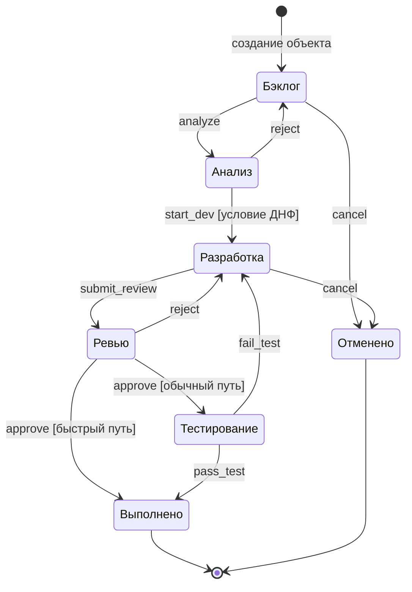
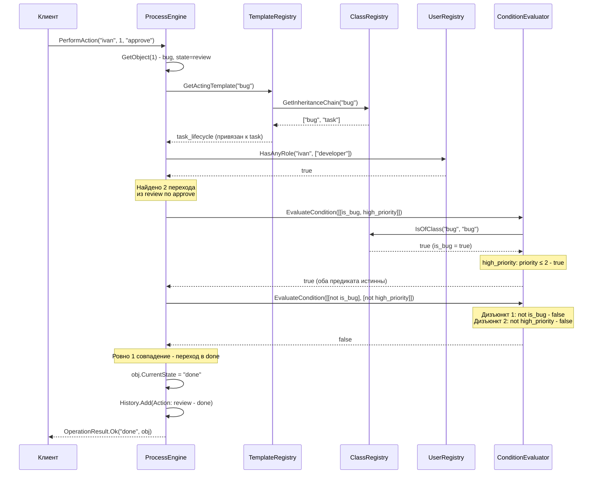
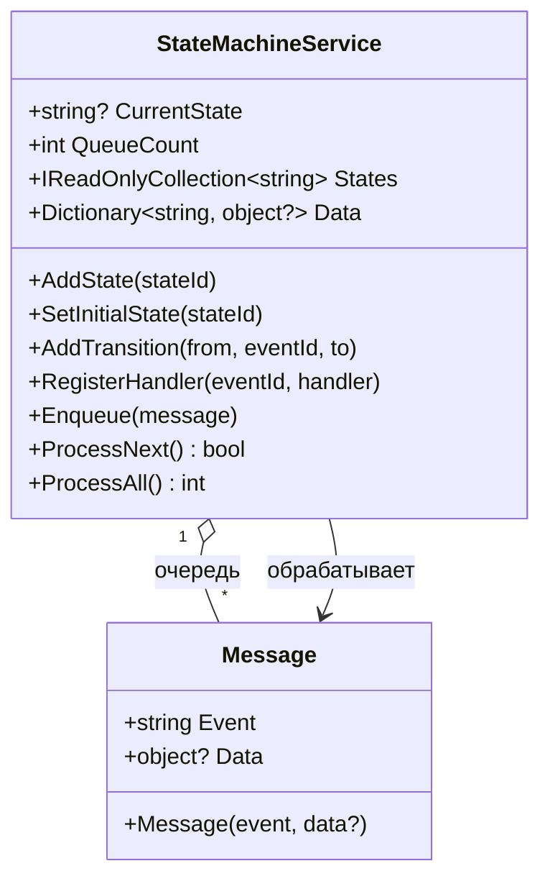

# Задание 3-1-1. Приёмы моделирования бизнес-логики

**Вариант 4** - Жизненный цикл задачи в системе управления проектами

---

## 1. Постановка задачи

Нужно сделать движок процессов - он исполняет жизненный цикл объектов по шаблону, который задаётся данными (YAML), а не кодом. Дополнительно реализовать сервис-класс, работающий как конечный автомат с очередью сообщений: каждое сообщение содержит событие, по которому выполняется логика обработчика и (опционально) переход в другое состояние. Состояния, переходы и обработчики добавляются динамически в рантайме.

Что должен уметь движок процессов:

- Классы объектов описываются в YAML с наследованием параметров (паттерн Type Object);
- Шаблон процесса задаёт состояния, действия, переходы с условиями в ДНФ и ограничениями по ролям;
- Движок создаёт объекты, выполняет действия с проверками, меняет параметры и ведёт журнал истории;
- Если сразу несколько переходов подходят по условиям - это ошибка шаблона, действие не выполняется;
- Операции атомарны: если что-то пошло не так, объект и история не меняются.

## 2. Предметная область

### 2.1 Классы объектов

Есть три типа задач, организованных в иерархию. Подкласс наследует параметры родителя, но может сузить допустимые диапазоны или добавить свои параметры.

| Класс | Родитель | Собственные параметры |
|-------|----------|----------------------|
| Задача (task) | - | title (string), description (string), priority (int, 1–5), estimated_hours (decimal, 0.5–1000) |
| Баг (bug) | Задача | priority (int, 1–**3** - сужен), severity (int, 1–5), steps_to_reproduce (string) |
| Фича (feature) | Задача | story_points (int, 1–21) |

Баг - это задача, но с более узким диапазоном приоритета (макс. 3 вместо 5) и двумя дополнительными полями. Фича добавляет story_points.

### 2.2 Роли и пользователи

| Пользователь | Роли |
|-------------|------|
| Анна К. (anna) | аналитик, менеджер проекта |
| Иван С. (ivan) | разработчик |
| Мария П. (maria) | тестировщик |
| Дмитрий В. (dmitry) | разработчик, тестировщик |

Создавать задачи могут только аналитики и менеджеры (`create_roles`). В каждом состоянии действия доступны только определённым ролям.

### 2.3 Жизненный цикл задачи

7 состояний (1 начальное, 2 конечных), 11 переходов, 8 действий, 7 предикатов.

- **Быстрый путь бага** (high_priority, т.е. priority ≤ 2): бэклог - анализ - разработка - ревью - **выполнено** (минуя тестирование);
- **Обычный путь**: бэклог - анализ - разработка - ревью - **тестирование** - выполнено.

#### Предикаты

| Предикат | Тип | Описание |
|----------|-----|----------|
| has_title | параметр, filled | Название заполнено |
| has_description | параметр, filled | Описание заполнено |
| priority_in_range | параметр, in_range | Приоритет в допустимом диапазоне класса |
| estimated_filled | параметр, filled | Оценка трудозатрат заполнена |
| estimated_in_range | параметр, in_range | Оценка в допустимом диапазоне класса |
| is_bug | класс | Объект принадлежит классу bug (или его подклассу) |
| high_priority | параметр, ≤ 2 | Приоритет ≤ 2 |

## 3. Архитектура решения

### 3.1 Структура проекта

```
Labs/
├── TaskTrackerApp.slnx
└── src/
    ├── TaskTracker.ProcessEngine/              # Библиотека (net9.0, YamlDotNet 16.3.0)
    │   ├── Models/
    │   │   ├── Definitions.cs                  # Модели YAML-определений
    │   │   └── ParameterType.cs                # Перечисление типов параметров
    │   ├── Engine/
    │   │   ├── ProcessEngine.cs                # Движок процессов
    │   │   ├── Registries.cs                   # ClassRegistry, UserRegistry, TemplateRegistry
    │   │   └── ConditionEvaluator.cs           # Вычислитель предикатов и условий ДНФ
    │   ├── Runtime/
    │   │   └── Runtime.cs                      # ProcessObject, HistoryEntry, OperationResult
    │   ├── Service/
    │   │   ├── Message.cs                      # Сообщение (event + data)
    │   │   └── StateMachineService.cs          # Сервис-КА с очередью сообщений
    │   └── YamlLoader.cs                       # Загрузка YAML-конфигурации
    └── TaskTracker.ProcessEngine.Tests/        # xUnit-тесты (39 сценариев)
        ├── ProcessEngineTests.cs               # 20 тестов движка процессов
        ├── StateMachineServiceTests.cs         # 19 тестов сервиса-КА
        ├── ServiceLogFixture.cs                # Фикстура логирования в файл
        └── TestData/
            ├── classes.yaml                    # 3 класса с наследованием
            ├── users.yaml                      # 4 роли, 4 пользователя
            ├── task_lifecycle.yaml             # Шаблон жизненного цикла задачи
            └── ambiguous_template.yaml         # Шаблон для теста неоднозначности
```

### 3.2 Применённые паттерны проектирования

| Паттерн | Где применён | Назначение |
|---------|-------------|-----------|
| Type Object | `ObjectClassDefinition`, `ClassRegistry` | Классы объектов описаны данными (YAML), а не классами языка |
| Flyweight | `TemplateRegistry` | Один шаблон процесса разделяется между всеми объектами класса |
| Specification | `PredicateDefinition`, `ConditionEvaluator` | Предикаты - объекты-правила, комбинируемые в ДНФ |
| Command | `ProcessEngine` (Create / Action / Modify) | Каждая операция проверяется, выполняется и записывается в журнал |
| State | `StateDefinition`, `TransitionDefinition` | Состояния и переходы жизненного цикла, заданные данными шаблона |
| Event Sourcing | `HistoryEntry`, `ProcessObject.History` | Хронологический журнал всех операций над объектом |
| Observer | `StateMachineService.RegisterHandler` | Обработчики подписываются на события и вызываются при обработке сообщений |
| Message Queue | `StateMachineService._queue` | Асинхронное взаимодействие через очередь сообщений (FIFO) |

## 4. UML-диаграммы

### 4.1 Диаграмма классов

| Класс | Назначение |
|-------|-----------|
| ProcessEngine | Выполняет все операции с объектами (создание, действия, изменение параметров) |
| ClassRegistry | Хранит классы объектов, строит цепочки наследования, собирает параметры |
| UserRegistry | Хранит пользователей, проверяет наличие ролей |
| TemplateRegistry | Хранит шаблоны процессов, находит подходящий по иерархии классов |
| ConditionEvaluator | Вычисляет предикаты и условия переходов в ДНФ |
| ProcessObject | Объект процесса: состояние, значения параметров, журнал истории |
| HistoryEntry | Запись в журнале: время, пользователь, тип операции, результат |
| OperationResult | Результат операции (успех/ошибка + сообщение) |
| YamlLoader | Загрузка классов, пользователей и шаблонов из YAML |
| StateMachineService | Сервис-конечный автомат с очередью сообщений (доп. задание) |
| Message | Сообщение для сервиса-КА: событие + данные |

```mermaid
classDiagram
    direction TB

    class ProcessEngine {
        +CreateObject(userId, classId, values) OperationResult
        +PerformAction(userId, objectId, actionId) OperationResult
        +ModifyParameter(userId, objectId, paramId, value) OperationResult
        +GetAvailableActions(userId, objectId) List~ActionDefinition~
        +GetObject(objectId) ProcessObject
        +GetHistory(objectId) List~HistoryEntry~
    }
    class ClassRegistry {
        +Load(ClassesFile)
        +GetClass(classId) ObjectClassDefinition
        +GetInheritanceChain(classId) List~string~
        +IsOfClass(objectClassId, classId) bool
        +GetEffectiveParameters(classId) List~ParameterDefinition~
    }
    class UserRegistry {
        +Load(UsersFile)
        +GetUser(userId) UserDefinition
        +HasAnyRole(userId, roleIds) bool
    }
    class TemplateRegistry {
        +Load(ProcessTemplateDefinition)
        +GetActingTemplate(classId) ProcessTemplateDefinition
    }
    class ConditionEvaluator {
        +EvaluatePredicate(pred, obj) bool
        +EvaluateCondition(condition, predicateMap, obj) bool
    }
    class ProcessObject {
        +int Id
        +string ClassId
        +string CurrentState
        +Dictionary ParameterValues
        +List~HistoryEntry~ History
    }
    class HistoryEntry {
        +DateTime Timestamp
        +string UserId
        +OperationType Operation
        +string Details
        +string NewState
    }
    class OperationResult {
        +bool Success
        +string Message
        +ProcessObject Object
        +Ok(msg, obj)$ OperationResult
        +Fail(msg)$ OperationResult
    }
    class OperationType {
        <<enumeration>>
        Create
        Action
        ModifyParameter
    }
    class ObjectClassDefinition {
        +string Id
        +string Title
        +string Parent
        +List~ParameterDefinition~ Parameters
    }
    class ParameterDefinition {
        +string Id
        +string Title
        +ParameterType Type
        +decimal Min
        +decimal Max
    }
    class ParameterType {
        <<enumeration>>
        Integer
        Decimal
        String
    }
    class ProcessTemplateDefinition {
        +string Process
        +string Title
        +string Class
        +List~string~ CreateRoles
        +List~ActionDefinition~ Actions
        +List~PredicateDefinition~ Predicates
        +List~StateDefinition~ States
        +List~TransitionDefinition~ Transitions
    }
    class StateDefinition {
        +string Id
        +string Title
        +bool Initial
        +bool Final
        +List~string~ Roles
        +bool EditParameters
    }
    class TransitionDefinition {
        +string From
        +string Action
        +string To
        +List Condition
    }
    class PredicateDefinition {
        +string Id
        +string Parameter
        +string Operator
        +object Value
        +string Class
    }
    class ActionDefinition {
        +string Id
        +string Title
    }
    class YamlLoader {
        +LoadClasses(yaml)$ ClassesFile
        +LoadUsers(yaml)$ UsersFile
        +LoadTemplate(yaml)$ ProcessTemplateDefinition
    }

    ProcessEngine --> ClassRegistry : использует
    ProcessEngine --> UserRegistry : использует
    ProcessEngine --> TemplateRegistry : использует
    ProcessEngine --> ConditionEvaluator : использует
    ProcessEngine "1" o-- "*" ProcessObject : управляет
    ConditionEvaluator --> ClassRegistry : использует
    TemplateRegistry --> ClassRegistry : использует
    ProcessObject "1" *-- "*" HistoryEntry : содержит
    HistoryEntry --> OperationType
    OperationResult o-- ProcessObject
    ObjectClassDefinition "1" *-- "*" ParameterDefinition
    ParameterDefinition --> ParameterType
    ProcessTemplateDefinition "1" *-- "*" ActionDefinition
    ProcessTemplateDefinition "1" *-- "*" PredicateDefinition
    ProcessTemplateDefinition "1" *-- "*" StateDefinition
    ProcessTemplateDefinition "1" *-- "*" TransitionDefinition
    YamlLoader ..> ObjectClassDefinition : создаёт
    YamlLoader ..> ProcessTemplateDefinition : создаёт
```



### 4.2 Диаграмма состояний



**Роли по состояниям:**

| Состояние | Роли | Редактирование параметров |
|-----------|------|--------------------------|
| Бэклог (начальное) | аналитик, менеджер проекта | да |
| Анализ | аналитик | да |
| Разработка | разработчик | нет |
| Ревью | разработчик | нет |
| Тестирование | тестировщик | нет |
| Выполнено (конечное) | - | - |
| Отменено (конечное) | - | - |

**Условия переходов (ДНФ):**

| Переход | Условие |
|---------|---------|
| анализ - разработка | `[has_title AND has_description AND priority_in_range AND estimated_filled AND estimated_in_range]` |
| ревью - выполнено (быстрый путь) | `[is_bug AND high_priority]` |
| ревью - тестирование (обычный путь) | `[NOT is_bug] OR [NOT high_priority]` |
| все остальные переходы | без условия (разрешены всегда) |

### 4.3 Диаграмма последовательности

Пример: одобряем баг с высоким приоритетом - он идёт по быстрому пути, минуя тестирование.



## 5. Описание реализации

### 5.1 YAML-конфигурация

Вся конфигурация лежит в трёх YAML-файлах. Загружаются через `YamlLoader` (библиотека YamlDotNet, формат snake_case).

**classes.yaml** - определения классов объектов с наследованием:

```yaml
classes:
  - id: task
    title: Задача
    parameters:
      - id: priority
        title: Приоритет
        type: integer
        min: 1
        max: 5
      # ... title, description, estimated_hours

  - id: bug
    title: Баг
    parent: task            # наследует параметры task
    parameters:
      - id: priority        # переопределяет min/max (1–3)
        title: Приоритет
        type: integer
        min: 1
        max: 3
      # ... severity, steps_to_reproduce
```

**users.yaml** - роли и пользователи:

```yaml
roles:
  - id: analyst
    title: Аналитик
  # ... developer, tester, pm

users:
  - id: anna
    name: Анна К.
    roles: [analyst, pm]
  # ... ivan, maria, dmitry
```

**task_lifecycle.yaml** - шаблон процесса: действия, предикаты, состояния, переходы с условиями в ДНФ:

```yaml
process: task_lifecycle
title: Жизненный цикл задачи
class: task
create_roles: [analyst, pm]

transitions:
  - from: review
    action: approve
    to: done
    condition:                          # ДНФ: список дизъюнктов
      - [is_bug, high_priority]         # конъюнкция: оба истинны
  - from: review
    action: approve
    to: testing
    condition:
      - [not is_bug]                    # дизъюнкт 1: не баг
      - [not high_priority]             # дизъюнкт 2: ИЛИ не высокий приоритет
```

### 5.2 Движок процессов

`ProcessEngine` - главный класс, через него проходят все операции с объектами:

**CreateObject** - создание объекта:
1. Ищем подходящий шаблон процесса (поднимаемся по иерархии классов);
2. Проверяем, что у пользователя есть роль из `create_roles`;
3. Проверяем начальные значения параметров на тип;
4. Создаём `ProcessObject` в начальном состоянии и пишем в историю.

**PerformAction** - выполнение действия:
1. Находим объект и его шаблон;
2. Проверяем: состояние не конечное, у пользователя подходящая роль;
3. Собираем все переходы из текущего состояния по этому действию (кандидаты);
4. Для каждого кандидата считаем условие в ДНФ через `ConditionEvaluator`;
5. Подошёл ровно один - выполняем. Ноль - условие не выполнено. Больше одного - ошибка шаблона.

**ModifyParameter** - изменение параметра:
1. Проверяем: состояние не конечное, `editParameters = true`, роль подходит;
2. Проверяем, что параметр существует для этого класса и значение правильного типа;
3. Обновляем значение и пишем в историю.

### 5.3 Вычисление условий в ДНФ

`ConditionEvaluator` отвечает за проверку условий переходов:

- **Предикат параметра**: берёт значение из `ProcessObject.ParameterValues` и применяет оператор (`filled`, `=`, `!=`, `<`, `<=`, `>`, `>=`, `in_range`). Если значение не задано - предикат ложен (кроме `filled`). `in_range` проверяет попадание в диапазон min/max с учётом наследования;
- **Предикат класса**: проверяет, принадлежит ли объект указанному классу (или его потомку) через `ClassRegistry.IsOfClass`;
- **Условие в ДНФ**: внешний список - это ИЛИ, внутренний - И. Перед предикатом можно написать `not` для отрицания. Если условие пустое или `null` - переход разрешён всегда.

### 5.4 Реестры

- **ClassRegistry** - знает про все классы. Умеет строить цепочку наследования, собирать итоговый набор параметров с учётом переопределений и проверять принадлежность объекта к классу;
- **UserRegistry** - хранит пользователей. Главный метод `HasAnyRole` - проверяет, есть ли у пользователя хотя бы одна из нужных ролей;
- **TemplateRegistry** - хранит шаблоны процессов. Для каждого класса ищет подходящий шаблон вверх по цепочке наследования (`GetActingTemplate`).

## 6. Сервис-конечный автомат (3-1-1 Additional)

### 6.1 Описание

`StateMachineService` - сервис-класс, который сам является конечным автоматом с очередью сообщений. В отличие от `ProcessEngine` (который управляет *внешними* объектами по YAML-шаблонам), `StateMachineService` - это сам автомат: он хранит своё состояние, принимает сообщения в очередь и обрабатывает их.

Ключевые возможности:
- **Очередь сообщений (FIFO)** - сообщения (`Message`) добавляются через `Enqueue` и обрабатываются по порядку;
- **Обработчики событий** - регистрируются через `RegisterHandler`, выполняют бизнес-логику и могут менять данные сервиса (`Data`);
- **Переходы состояний** - регистрируются через `AddTransition`, выполняются автоматически при обработке сообщения;
- **Динамическая конфигурация** - состояния, переходы и обработчики можно добавлять в любой момент, в том числе после старта;
- **Логирование** - каждое действие логируется через callback `Action<string>` с подробным описанием: какие состояния, что в очереди, что изменилось в данных.

Обработчик и переход - независимые механизмы. Обработчик выполняет логику, переход меняет состояние. Они могут работать вместе, по отдельности или отсутствовать - любая комбинация допустима.

### 6.2 Диаграмма классов



### 6.3 Пример использования

```csharp
var svc = new StateMachineService(msg => Console.WriteLine(msg));

// Конфигурация автомата
svc.AddState("idle");
svc.AddState("working");
svc.AddState("done");
svc.SetInitialState("idle");
svc.AddTransition("idle", "start", "working");
svc.AddTransition("working", "finish", "done");

// Обработчики меняют данные сервиса
svc.RegisterHandler("start", msg =>
{
    svc.Data["assignee"] = "ivan";
    svc.Data["progress"] = "в работе";
});
svc.RegisterHandler("finish", msg =>
{
    svc.Data["progress"] = "завершено";
    svc.Data["result"] = "success";
});

// Отправка и обработка сообщений
svc.Enqueue(new Message("start"));
svc.Enqueue(new Message("finish"));
svc.ProcessAll();
// Состояние: "done", Data: {assignee=ivan, progress=завершено, result=success}
```

## 7. Тестирование

Всего 39 тестов на xUnit (20 для ProcessEngine + 19 для StateMachineService).

### 7.1 Тесты ProcessEngine (20 сценариев)

| Категория | Сценарии | Количество |
|-----------|----------|-----------|
| Полный жизненный цикл | Быстрый путь бага (- done минуя тестирование), обычный путь фичи (- testing - done) | 2 |
| Возвраты и циклы | Reject из ревью - разработка, fail_test - разработка | 2 |
| Отмена | Cancel из бэклога, действия в конечном состоянии отклоняются | 2 |
| Наследование классов | Баг наследует шаблон задачи, фича наследует и добавляет параметры | 2 |
| Переопределение диапазонов | Баг: priority > 3 не проходит in_range, после изменения на 2 - проходит | 1 |
| Условия ДНФ | Неполные данные - start_dev отклонён, null-значения - предикат ложен | 2 |
| Проверка ролей | Создание без роли, действие без роли, изменение параметра без роли | 3 |
| Запрет редактирования | Изменение параметра в состоянии с editParameters = false | 1 |
| Валидация типов | Неверный тип параметра, несуществующий параметр | 2 |
| Неоднозначность шаблона | Два перехода с выполненными условиями - ошибка | 1 |
| История операций | Запись всех типов операций (Create, ModifyParameter, Action) | 1 |
| Доступные действия | GetAvailableActions возвращает корректный список для роли | 1 |

### 7.2 Тесты StateMachineService (19 сценариев)

| Категория | Сценарии | Количество |
|-----------|----------|-----------|
| Регистрация состояний | Добавление, дубликат выбрасывает исключение | 2 |
| Начальное состояние | Установка, попытка установить несуществующее | 2 |
| Переходы | Недопустимое исходное/целевое состояние | 2 |
| Обработка с обработчиком | Обработчик + переход, обработчик без перехода | 2 |
| Обработка без обработчика | Переход без обработчика, пустая очередь | 2 |
| ProcessAll | Несколько сообщений подряд, пустая очередь | 2 |
| Данные сообщения | Обработчик получает Data и записывает в хранилище сервиса | 1 |
| Неизвестное событие | Состояние не меняется | 1 |
| Динамическая конфигурация | Добавление состояний/переходов/обработчиков в рантайме | 2 |
| Очередь FIFO | Порядок обработки совпадает с порядком добавления | 1 |
| Счётчик очереди | QueueCount корректно отражает размер | 1 |
| Замена обработчика | Повторная регистрация заменяет предыдущий | 1 |

Логи тестов записываются в `bin/Debug/net9.0/service-tests.log` с разделителями `--- Тест N ---` и подробным описанием каждого действия (добавление состояний, содержимое очереди, изменение данных до/после обработчика).

Запуск:

```
dotnet test src/TaskTracker.ProcessEngine.Tests
```

## 8. Сборка и запуск

**Требования**: .NET SDK 9.0

```bash
# Сборка
dotnet build

# Запуск тестов
dotnet test src/TaskTracker.ProcessEngine.Tests

# Запуск тестов с подробным выводом
dotnet test src/TaskTracker.ProcessEngine.Tests --verbosity normal
```

После запуска тестов лог StateMachineService доступен по пути:
```
src/TaskTracker.ProcessEngine.Tests/bin/Debug/net9.0/service-tests.log
```

Из внешних зависимостей - только YamlDotNet (парсинг YAML) и xUnit (тесты). Всё ставится автоматически через NuGet при сборке.
