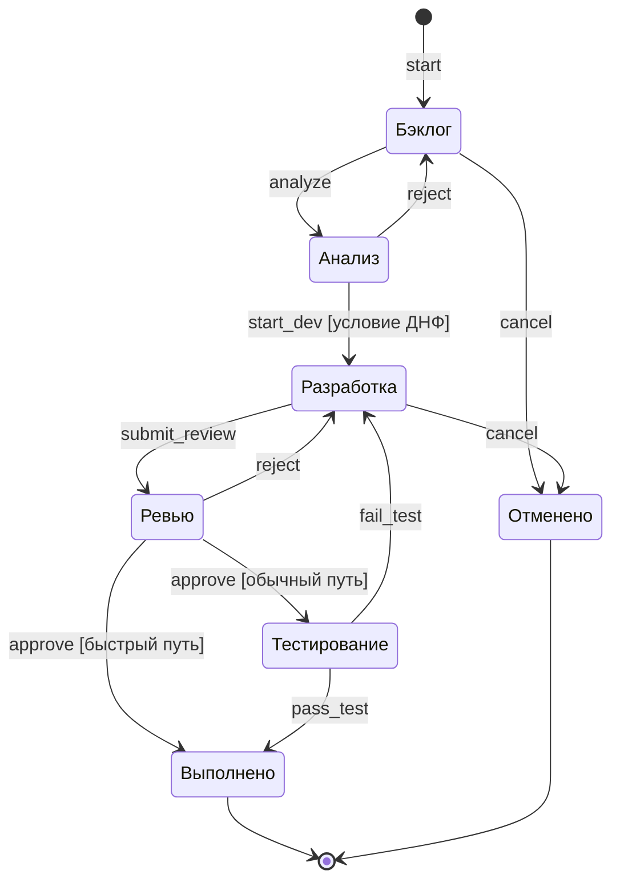
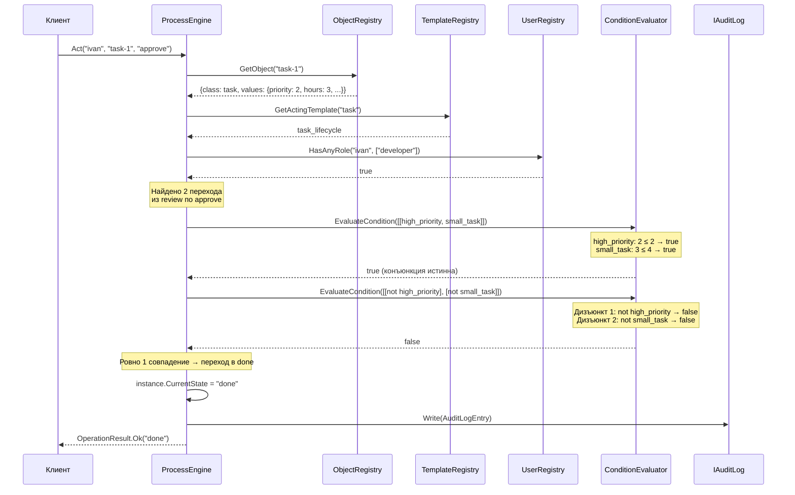
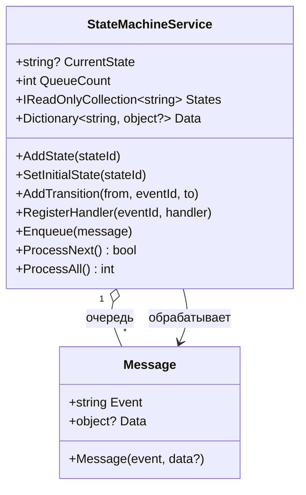

# Задание 3-1-1. Приёмы моделирования бизнес-логики

**Вариант 4** - Жизненный цикл задачи в системе управления проектами

---

## 1. Постановка задачи

Нужно сделать движок процессов - он исполняет жизненный цикл объектов по шаблону, который задаётся данными (YAML), а не кодом. Дополнительно реализовать сервис-класс, работающий как конечный автомат с очередью сообщений: каждое сообщение содержит событие, по которому выполняется логика обработчика и (опционально) переход в другое состояние. Состояния, переходы и обработчики добавляются динамически в рантайме.

Что должен уметь движок процессов:

- Классы объектов описываются в YAML с наследованием параметров (паттерн Type Object);
- Объекты загружаются из конфигурации (objects.yaml), значения по умолчанию подставляются из описания класса;
- Шаблон процесса задаёт состояния, действия, переходы с условиями в ДНФ и ограничениями по ролям;
- Шаблон привязан строго к своему классу (не наследуется подклассами);
- Две команды: `start(user, object)` запускает процесс над объектом, `action(user, object, action)` выполняет действие;
- Если сразу несколько переходов подходят по условиям - это ошибка шаблона, действие не выполняется;
- Все операции записываются в аудит-лог (JSON Lines);
- Операции атомарны: если что-то пошло не так, состояние процесса не меняется.

## 2. Предметная область

### 2.1 Классы объектов

Есть три типа задач, организованных в иерархию. Подкласс наследует параметры родителя, но может сузить допустимые диапазоны или добавить свои параметры.

| Класс | Родитель | Собственные параметры |
|-------|----------|----------------------|
| Задача (task) | - | title (string), description (string), priority (int, 1–5), estimated_hours (decimal, 0.5–1000) |
| Баг (bug) | Задача | priority (int, 1–**3** - сужен), severity (int, 1–5), steps_to_reproduce (string) |
| Фича (feature) | Задача | story_points (int, 1–21) |

Баг - это задача, но с более узким диапазоном приоритета (макс. 3 вместо 5) и двумя дополнительными полями. Фича добавляет story_points.

### 2.2 Роли и пользователи

| Пользователь | Роли |
|-------------|------|
| Анна К. (anna) | аналитик, менеджер проекта |
| Иван С. (ivan) | разработчик |
| Мария П. (maria) | тестировщик |
| Дмитрий В. (dmitry) | разработчик, тестировщик |

Создавать задачи могут только аналитики и менеджеры (`create_roles`). В каждом состоянии действия доступны только определённым ролям.

### 2.3 Готовые объекты

Объекты загружаются из `objects.yaml`. Каждый объект привязан к классу и может содержать значения параметров. Если значение не задано, подставляется `default` из описания класса.

| Объект | Класс | Назначение |
|--------|-------|-----------|
| task-1 | task | Быстрый трек (priority=2, hours=3) |
| task-normal | task | Обычный трек (priority=3, hours=10) |
| task-minimal | task | Все значения из default (priority=3, hours=8) |
| task-explicit-null | task | Явный null: priority=null при default=3 |
| task-no-desc | task | Без описания — start_dev не пройдёт |
| bug-1 | bug | Демонстрация наследования |
| feature-1 | feature | Демонстрация наследования |

### 2.4 Жизненный цикл задачи

7 состояний (1 начальное, 2 конечных), 11 переходов, 8 действий, 7 предикатов.

- **Быстрый путь** (high_priority AND small_task, т.е. priority ≤ 2 И estimated_hours ≤ 4): бэклог → анализ → разработка → ревью → **выполнено** (минуя тестирование);
- **Обычный путь**: бэклог → анализ → разработка → ревью → **тестирование** → выполнено.

#### Предикаты

| Предикат | Тип | Описание |
|----------|-----|----------|
| has_title | параметр, filled | Название заполнено |
| has_description | параметр, filled | Описание заполнено |
| priority_in_range | параметр, in_range | Приоритет в допустимом диапазоне класса |
| estimated_filled | параметр, filled | Оценка трудозатрат заполнена |
| estimated_in_range | параметр, in_range | Оценка в допустимом диапазоне класса |
| high_priority | параметр, ≤ 2 | Приоритет ≤ 2 |
| small_task | параметр, ≤ 4 | Оценка трудозатрат ≤ 4 часов |

## 3. Архитектура решения

### 3.1 Структура проекта

```
Labs/
├── TaskTrackerApp.slnx
└── src/
    ├── TaskTracker.ProcessEngine/              # Библиотека (net9.0, YamlDotNet 16.3.0)
    │   ├── Models/
    │   │   ├── Definitions.cs                  # Модели YAML-определений
    │   │   └── ParameterType.cs                # Перечисление типов параметров
    │   ├── Engine/
    │   │   ├── ProcessEngine.cs                # Движок процессов (start / act)
    │   │   ├── Registries.cs                   # ClassRegistry, UserRegistry, TemplateRegistry, ObjectRegistry
    │   │   ├── ConditionEvaluator.cs           # Вычислитель предикатов и условий ДНФ
    │   │   └── AuditLog.cs                     # IAuditLog, JsonLinesLog (JSONL), MemoryLog (тесты)
    │   ├── Runtime/
    │   │   └── Runtime.cs                      # ProcessInstance, OperationResult
    │   ├── Service/
    │   │   ├── Message.cs                      # Сообщение (event + data)
    │   │   └── StateMachineService.cs          # Сервис-КА с очередью сообщений
    │   └── YamlLoader.cs                       # Загрузка YAML-конфигурации
    └── TaskTracker.ProcessEngine.Tests/        # xUnit-тесты (38 сценариев)
        ├── ProcessEngineTests.cs               # 19 тестов движка процессов
        ├── StateMachineServiceTests.cs         # 19 тестов сервиса-КА
        ├── ServiceLogFixture.cs                # Фикстура логирования в файл
        └── TestData/
            ├── classes.yaml                    # 3 класса с наследованием (+ default-значения)
            ├── users.yaml                      # 4 роли, 4 пользователя
            ├── objects.yaml                    # 6 готовых объектов
            ├── task_lifecycle.yaml             # Шаблон жизненного цикла задачи
            └── ambiguous_template.yaml         # Шаблон для теста неоднозначности
```

### 3.2 Применённые паттерны проектирования

| Паттерн | Где применён | Назначение |
|---------|-------------|-----------|
| Type Object | `ObjectClassDefinition`, `ClassRegistry` | Классы объектов описаны данными (YAML), а не классами языка |
| Flyweight | `TemplateRegistry` | Один шаблон процесса разделяется между всеми объектами класса |
| Specification (Interpreter, процедурный) | `PredicateDefinition`, `ConditionEvaluator` | Предикаты — объекты-правила, комбинируемые в ДНФ; evaluator интерпретирует их процедурно |
| Command | `ProcessEngine` (Start / Act) | Каждая операция проверяется, выполняется и записывается в аудит-лог |
| State | `StateDefinition`, `TransitionDefinition` | Состояния и переходы жизненного цикла, заданные данными шаблона |
| Audit Log | `IAuditLog`, `JsonLinesLog`, `MemoryLog` | Хронологический журнал всех операций в формате JSON Lines |
| Observer | `StateMachineService.RegisterHandler` | Обработчики подписываются на события и вызываются при обработке сообщений |
| Message Queue | `StateMachineService._queue` | Асинхронное взаимодействие через очередь сообщений (FIFO) |

## 4. UML-диаграммы

### 4.1 Диаграмма классов

| Класс | Назначение |
|-------|-----------|
| ProcessEngine | Запускает процессы (`Start`) и выполняет действия (`Act`) с аудит-логированием |
| ClassRegistry | Хранит классы объектов, строит цепочки наследования, собирает эффективные параметры |
| UserRegistry | Хранит пользователей, проверяет наличие ролей |
| TemplateRegistry | Хранит шаблоны процессов, привязка строго по классу (без наследования) |
| ObjectRegistry | Загружает объекты из конфигурации, применяет default-значения и приведение типов |
| ConditionEvaluator | Вычисляет предикаты и условия переходов в ДНФ |
| ProcessInstance | Экземпляр запущенного процесса: текущее состояние |
| OperationResult | Результат операции (успех/ошибка + состояние до/после) |
| IAuditLog / JsonLinesLog / MemoryLog | Аудит-лог: интерфейс, JSONL-реализация (файл), in-memory (тесты) |
| YamlLoader | Загрузка классов, пользователей, объектов и шаблонов из YAML |
| StateMachineService | Сервис-конечный автомат с очередью сообщений (доп. задание) |
| Message | Сообщение для сервиса-КА: событие + данные |

```mermaid
classDiagram
    direction TB

    class ProcessEngine {
        +Start(userId, objectId) OperationResult
        +Act(userId, objectId, actionId) OperationResult
        +GetProcess(objectId) ProcessInstance
    }
    class ClassRegistry {
        +Load(ClassesFile)
        +GetClass(classId) ObjectClassDefinition
        +GetInheritanceChain(classId) List~string~
        +IsOfClass(objectClassId, classId) bool
        +GetEffectiveParameters(classId) List~ParameterDefinition~
    }
    class UserRegistry {
        +Load(UsersFile)
        +GetUser(userId) UserDefinition
        +HasAnyRole(userId, roleIds) bool
        +Exists(userId) bool
    }
    class TemplateRegistry {
        +Load(ProcessTemplateDefinition)
        +GetActingTemplate(classId) ProcessTemplateDefinition
    }
    class ObjectRegistry {
        +Load(ObjectsFile, ClassRegistry)
        +GetObject(objectId) ObjectDefinition
        +Exists(objectId) bool
    }
    class ConditionEvaluator {
        +EvaluatePredicate(pred, classId, values) bool
        +EvaluateCondition(condition, predicateMap, classId, values) bool
    }
    class ProcessInstance {
        +string ObjectId
        +string TemplateClass
        +string CurrentState
    }
    class OperationResult {
        +bool Success
        +string Message
        +string StateBefore
        +string StateAfter
        +Ok(msg, before, after)$ OperationResult
        +Fail(msg, before)$ OperationResult
    }
    class IAuditLog {
        <<interface>>
        +Write(AuditLogEntry)
    }
    class AuditLogEntry {
        +object Command
        +string User
        +string Object
        +string StateBefore
        +string StateAfter
        +string Result
        +string Reason
    }
    class ObjectClassDefinition {
        +string Id
        +string Title
        +string Parent
        +List~ParameterDefinition~ Parameters
    }
    class ParameterDefinition {
        +string Id
        +string Title
        +ParameterType Type
        +decimal Min
        +decimal Max
        +object Default
    }
    class ParameterType {
        <<enumeration>>
        Integer
        Decimal
        String
    }
    class ObjectDefinition {
        +string Id
        +string Class
        +Dictionary Values
    }
    class ProcessTemplateDefinition {
        +string Process
        +string Title
        +string Class
        +List~string~ CreateRoles
        +List~ActionDefinition~ Actions
        +List~PredicateDefinition~ Predicates
        +List~StateDefinition~ States
        +List~TransitionDefinition~ Transitions
    }
    class StateDefinition {
        +string Id
        +string Title
        +bool Initial
        +bool Final
        +List~string~ Roles
    }
    class TransitionDefinition {
        +string From
        +string Action
        +string To
        +List Condition
    }
    class PredicateDefinition {
        +string Id
        +string Parameter
        +string Operator
        +object Value
        +string Class
    }
    class ActionDefinition {
        +string Id
        +string Title
    }
    class YamlLoader {
        +LoadClasses(yaml)$ ClassesFile
        +LoadUsers(yaml)$ UsersFile
        +LoadObjects(yaml)$ ObjectsFile
        +LoadTemplate(yaml)$ ProcessTemplateDefinition
    }

    ProcessEngine --> ClassRegistry : использует
    ProcessEngine --> UserRegistry : использует
    ProcessEngine --> TemplateRegistry : использует
    ProcessEngine --> ObjectRegistry : использует
    ProcessEngine --> ConditionEvaluator : использует
    ProcessEngine --> IAuditLog : пишет лог
    ProcessEngine "1" o-- "*" ProcessInstance : управляет
    ConditionEvaluator --> ClassRegistry : использует
    ObjectRegistry --> ClassRegistry : применяет defaults
    IAuditLog "1" *-- "*" AuditLogEntry : хранит
    ObjectClassDefinition "1" *-- "*" ParameterDefinition
    ParameterDefinition --> ParameterType
    ProcessTemplateDefinition "1" *-- "*" ActionDefinition
    ProcessTemplateDefinition "1" *-- "*" PredicateDefinition
    ProcessTemplateDefinition "1" *-- "*" StateDefinition
    ProcessTemplateDefinition "1" *-- "*" TransitionDefinition
    YamlLoader ..> ObjectClassDefinition : создаёт
    YamlLoader ..> ObjectDefinition : создаёт
    YamlLoader ..> ProcessTemplateDefinition : создаёт
```



### 4.2 Диаграмма состояний



**Роли по состояниям:**

| Состояние | Роли |
|-----------|------|
| Бэклог (начальное) | аналитик, менеджер проекта |
| Анализ | аналитик |
| Разработка | разработчик |
| Ревью | разработчик |
| Тестирование | тестировщик |
| Выполнено (конечное) | - |
| Отменено (конечное) | - |

**Условия переходов (ДНФ):**

| Переход | Условие |
|---------|---------|
| анализ → разработка | `[has_title AND has_description AND priority_in_range AND estimated_filled AND estimated_in_range]` |
| ревью → выполнено (быстрый путь) | `[high_priority AND small_task]` |
| ревью → тестирование (обычный путь) | `[NOT high_priority] OR [NOT small_task]` |
| все остальные переходы | без условия (разрешены всегда) |

### 4.3 Диаграмма последовательности

Пример: одобряем задачу task-1 (priority=2, hours=3) — она идёт по быстрому пути, минуя тестирование.



## 5. Описание реализации

### 5.1 YAML-конфигурация

Конфигурация лежит в четырёх YAML-файлах. Загружаются через `YamlLoader` (библиотека YamlDotNet, формат snake_case).

**classes.yaml** — определения классов объектов с наследованием и default-значениями:

```yaml
classes:
  - id: task
    title: Задача
    parameters:
      - id: priority
        title: Приоритет
        type: integer
        min: 1
        max: 5
        default: 3                      # значение по умолчанию
      - id: estimated_hours
        title: Оценка трудозатрат
        type: decimal
        min: 0.5
        max: 1000
        default: 8
      # ... title, description

  - id: bug
    title: Баг
    parent: task                        # наследует параметры task
    parameters:
      - id: priority                    # переопределяет min/max (1–3)
        title: Приоритет
        min: 1
        max: 3
      # ... severity, steps_to_reproduce
```

**objects.yaml** — готовые объекты (привязаны к классу, значения подставляются из default при отсутствии):

```yaml
objects:
  - id: task-1
    class: task
    values:
      title: "Реализовать авторизацию"
      description: "Добавить OAuth2"
      priority: 2
      estimated_hours: 3

  - id: task-minimal                    # все значения из default
    class: task
```

**users.yaml** — роли и пользователи:

```yaml
roles:
  - id: analyst
    title: Аналитик
  # ... developer, tester, pm

users:
  - id: anna
    name: Анна К.
    roles: [analyst, pm]
  # ... ivan, maria, dmitry
```

**task_lifecycle.yaml** — шаблон процесса: действия, предикаты, состояния, переходы с условиями в ДНФ:

```yaml
process: task_lifecycle
title: Жизненный цикл задачи
class: task                             # привязка строго к классу (не наследуется)
create_roles: [analyst, pm]

predicates:
  - id: high_priority
    parameter: priority
    operator: "<="
    value: 2
  - id: small_task
    parameter: estimated_hours
    operator: "<="
    value: 4

transitions:
  - from: review
    action: approve
    to: done
    condition:                          # ДНФ: список дизъюнктов
      - [high_priority, small_task]     # конъюнкция: оба истинны → быстрый трек
  - from: review
    action: approve
    to: testing
    condition:
      - [not high_priority]             # дизъюнкт 1: НЕ высокий приоритет
      - [not small_task]                # дизъюнкт 2: ИЛИ НЕ малая задача
```

### 5.2 Движок процессов

`ProcessEngine` — главный класс с двумя командами:

**Start(userId, objectId)** — запуск процесса над объектом:
1. Проверяем существование пользователя и объекта;
2. Проверяем, что процесс ещё не запущен для данного объекта;
3. Ищем шаблон строго по классу объекта (без наследования);
4. Проверяем, что у пользователя есть роль из `create_roles`;
5. Создаём `ProcessInstance` в начальном состоянии и пишем в аудит-лог.

**Act(userId, objectId, actionId)** — выполнение действия:
1. Находим объект и экземпляр процесса;
2. Проверяем: состояние не конечное, у пользователя подходящая роль;
3. Собираем все переходы из текущего состояния по этому действию (кандидаты);
4. Для каждого кандидата считаем условие в ДНФ через `ConditionEvaluator`;
5. Подошёл ровно один — выполняем. Ноль — условие не выполнено. Больше одного — ошибка шаблона;
6. Пишем результат в аудит-лог (и успехи, и отказы).

### 5.3 Вычисление условий в ДНФ

`ConditionEvaluator` отвечает за проверку условий переходов. Принимает `classId` и `Dictionary<string, object?>` значений:

- **Предикат параметра**: берёт значение из словаря объекта и применяет оператор (`filled`, `=`, `!=`, `<`, `<=`, `>`, `>=`, `in_range`). Если значение не задано — предикат ложен (кроме `filled`). `in_range` проверяет попадание в диапазон min/max с учётом наследования;
- **Предикат класса**: проверяет, принадлежит ли объект указанному классу (или его потомку) через `ClassRegistry.IsOfClass`;
- **Условие в ДНФ**: внешний список — это ИЛИ, внутренний — И. Перед предикатом можно написать `not` для отрицания. Если условие пустое или `null` — переход разрешён всегда.

### 5.4 Реестры

- **ClassRegistry** — знает про все классы. Умеет строить цепочку наследования, собирать итоговый набор параметров (с default) с учётом переопределений и проверять принадлежность объекта к классу;
- **UserRegistry** — хранит пользователей. Главный метод `HasAnyRole` — проверяет, есть ли у пользователя хотя бы одна из нужных ролей;
- **TemplateRegistry** — хранит шаблоны процессов. Привязка строго к классу: `GetActingTemplate` ищет шаблон только для указанного класса, без подъёма по цепочке наследования;
- **ObjectRegistry** — загружает объекты из `objects.yaml`, применяет default-значения из описания класса и приводит типы (`int`, `decimal`, `string`) в соответствии с `ParameterType`.

### 5.5 Аудит-лог

`IAuditLog` — интерфейс аудит-лога с единственным методом `Write(AuditLogEntry)`:

- **JsonLinesLog** — запись в файл в формате JSON Lines (по одной JSON-строке на запись). Используется в production;
- **MemoryLog** — хранит записи в `List<AuditLogEntry>` в памяти. Используется в тестах для проверки корректности логирования.

Каждая запись содержит: команду (`command`), пользователя, объект, состояние до/после, результат (`accepted` / `rejected` / `error`) и причину отказа.

## 6. Сервис-конечный автомат (3-1-1 Additional)

### 6.1 Описание

`StateMachineService` - сервис-класс, который сам является конечным автоматом с очередью сообщений. В отличие от `ProcessEngine` (который управляет *внешними* объектами по YAML-шаблонам), `StateMachineService` - это сам автомат: он хранит своё состояние, принимает сообщения в очередь и обрабатывает их.

Ключевые возможности:
- **Очередь сообщений (FIFO)** - сообщения (`Message`) добавляются через `Enqueue` и обрабатываются по порядку;
- **Обработчики событий** - регистрируются через `RegisterHandler`, выполняют бизнес-логику и могут менять данные сервиса (`Data`);
- **Переходы состояний** - регистрируются через `AddTransition`, выполняются автоматически при обработке сообщения;
- **Динамическая конфигурация** - состояния, переходы и обработчики можно добавлять в любой момент, в том числе после старта;
- **Логирование** - каждое действие логируется через callback `Action<string>` с подробным описанием: какие состояния, что в очереди, что изменилось в данных.

Обработчик и переход - независимые механизмы. Обработчик выполняет логику, переход меняет состояние. Они могут работать вместе, по отдельности или отсутствовать - любая комбинация допустима.

### 6.2 Диаграмма классов



### 6.3 Пример использования

```csharp
var svc = new StateMachineService(msg => Console.WriteLine(msg));

// Конфигурация автомата
svc.AddState("idle");
svc.AddState("working");
svc.AddState("done");
svc.SetInitialState("idle");
svc.AddTransition("idle", "start", "working");
svc.AddTransition("working", "finish", "done");

// Обработчики меняют данные сервиса
svc.RegisterHandler("start", msg =>
{
    svc.Data["assignee"] = "ivan";
    svc.Data["progress"] = "в работе";
});
svc.RegisterHandler("finish", msg =>
{
    svc.Data["progress"] = "завершено";
    svc.Data["result"] = "success";
});

// Отправка и обработка сообщений
svc.Enqueue(new Message("start"));
svc.Enqueue(new Message("finish"));
svc.ProcessAll();
// Состояние: "done", Data: {assignee=ivan, progress=завершено, result=success}
```

## 7. Тестирование

Всего 38 тестов на xUnit (19 для ProcessEngine + 19 для StateMachineService).

### 7.1 Тесты ProcessEngine (19 сценариев)

| Категория | Сценарии | Количество |
|-----------|----------|-----------|
| Полный жизненный цикл | Быстрый трек task-1 → done (минуя тестирование), обычный путь task-normal → testing → done | 2 |
| Возвраты | Reject из ревью → разработка, повторная отправка на ревью | 1 |
| Проверка ролей | Действие без роли, запуск процесса без роли | 2 |
| Условия ДНФ | Нет описания → start_dev отклонён, ДНФ OR-ветки обе истинны | 2 |
| Наследование классов | Баг: priority max=3 (сужен), фича наследует + добавляет story_points | 2 |
| Default-значения | task-minimal: priority=3, estimated_hours=8 из default | 1 |
| Явный null не заменяется default | task-explicit-null: priority=null при default=3 | 1 |
| Аудит-лог | Записи успехов и отказов с корректными полями | 1 |
| Отказ не меняет состояние | Неуспешное действие оставляет состояние прежним | 1 |
| Повторный запуск | Запуск процесса дважды → отклонён | 1 |
| Конечное состояние | Действие в cancelled → отклонено | 1 |
| Предикат класса | IsOfClass: bug → task (true), task → bug (false) | 1 |
| Нет шаблона | Запуск bug-1 → нет шаблона для класса bug | 1 |
| Несуществующий объект | Запуск для несуществующего объекта → отклонён | 1 |
| Неоднозначность шаблона | Два перехода с выполненными условиями → ошибка | 1 |

### 7.2 Тесты StateMachineService (19 сценариев)

| Категория | Сценарии | Количество |
|-----------|----------|-----------|
| Регистрация состояний | Добавление, дубликат выбрасывает исключение | 2 |
| Начальное состояние | Установка, попытка установить несуществующее | 2 |
| Переходы | Недопустимое исходное/целевое состояние | 2 |
| Обработка с обработчиком | Обработчик + переход, обработчик без перехода | 2 |
| Обработка без обработчика | Переход без обработчика, пустая очередь | 2 |
| ProcessAll | Несколько сообщений подряд, пустая очередь | 2 |
| Данные сообщения | Обработчик получает Data и записывает в хранилище сервиса | 1 |
| Неизвестное событие | Состояние не меняется | 1 |
| Динамическая конфигурация | Добавление состояний/переходов/обработчиков в рантайме | 2 |
| Очередь FIFO | Порядок обработки совпадает с порядком добавления | 1 |
| Счётчик очереди | QueueCount корректно отражает размер | 1 |
| Замена обработчика | Повторная регистрация заменяет предыдущий | 1 |

Логи тестов записываются в `bin/Debug/net9.0/service-tests.log` с разделителями `--- Тест N ---` и подробным описанием каждого действия (добавление состояний, содержимое очереди, изменение данных до/после обработчика).

Запуск:

```
dotnet test src/TaskTracker.ProcessEngine.Tests
```

## 8. Сборка и запуск

**Требования**: .NET SDK 9.0

```bash
# Сборка
dotnet build

# Запуск тестов
dotnet test src/TaskTracker.ProcessEngine.Tests

# Запуск тестов с подробным выводом
dotnet test src/TaskTracker.ProcessEngine.Tests --verbosity normal
```

После запуска тестов лог StateMachineService доступен по пути:
```
src/TaskTracker.ProcessEngine.Tests/bin/Debug/net9.0/service-tests.log
```

Из внешних зависимостей - только YamlDotNet (парсинг YAML) и xUnit (тесты). Всё ставится автоматически через NuGet при сборке.
